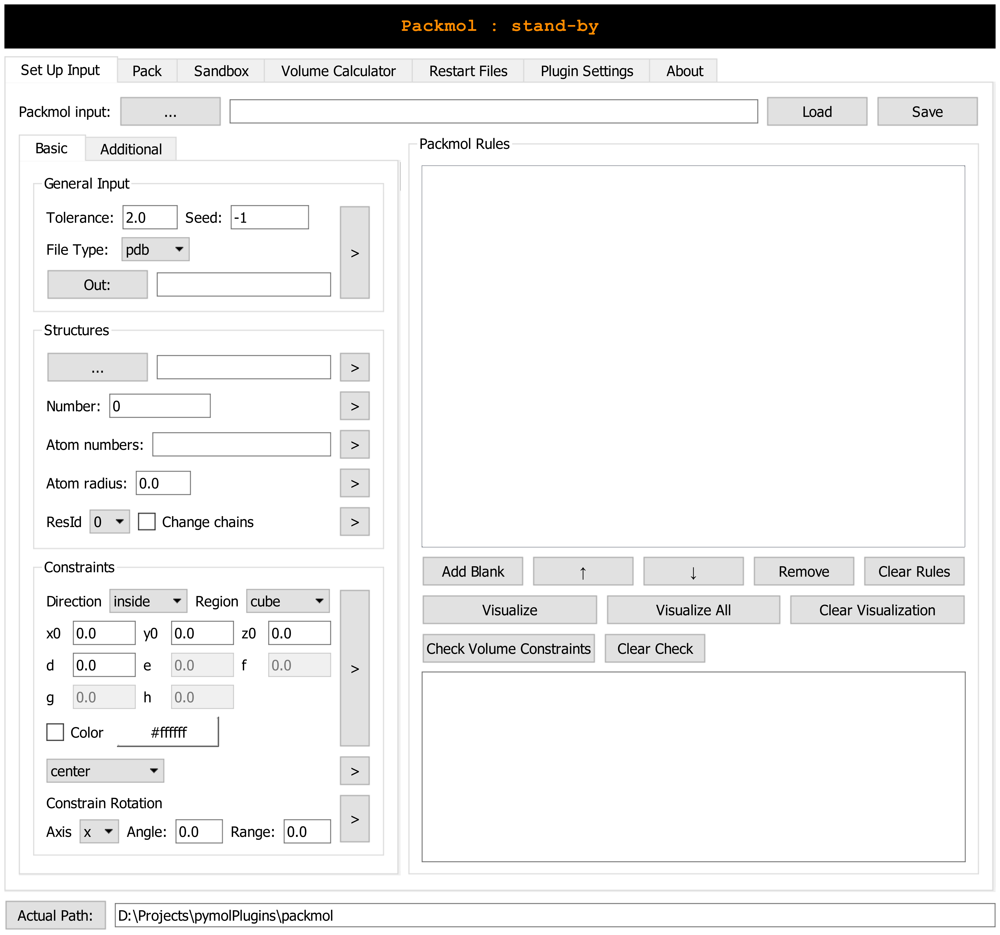

# pyPackmol

pyPackmol is a [PyMOL](https://pymol.org/) plugin that gives [Packmol](https://m3g.github.io/packmol/)
a graphical interface. Build Packmol input files, see their constraints in 3D, check volumes, run
Packmol and rebuild systems from restart files, all without leaving PyMOL.

Current version: **v0.56**.



## Features

- **Set Up Input**: build Packmol input files (`.inp`) from a rules tree instead of typing keywords
  by hand. Load and save `.inp` files, including all Packmol 21.2.3 keywords.
- **Constraint visualization**: boxes, spheres, cylinders, ellipsoids, planes and the other
  constraints are drawn as CGO objects with labels. Each constraint can have its own colour,
  saved in the `.inp` file as a `# color #rrggbb` comment.
- **Volume checks**: compare molecular volumes with constraint volumes before packing. Two
  methods for molecular volumes: ConvexHull (SciPy) or [MoloVol](https://github.com/jmaglic/MoloVol)
  (pure-Python voxel algorithm).
- **Pack**: run Packmol in the background without freezing PyMOL, with automatic retries,
  optional loading of partial solutions and loading of the final structure.
- **Sandbox**: create helper boxes and spheres around existing molecules and move objects.
- **Restart Files**: rebuild a packed system, whole or in part, from Packmol restart files.

## Requirements

- PyMOL 2.0 or later, with its Qt interface (PyMOL 2.5+ or 3.x recommended).
- NumPy and SciPy in PyMOL's Python (SciPy is needed for the volume checks).
  Check with `import numpy, scipy` in the PyMOL command line.
- A [Packmol](https://m3g.github.io/packmol/) executable. If `packmol` is on your `PATH`, the
  plugin finds it automatically.

## Installation

1. Copy the plugin folder **without** the `legacy/` and `docs/` subfolders, but keep `LICENSE` and
   `LICENSE-MoloVol.txt`. The folder name must be a valid Python package name, for example
   `pyPackmol`.
2. In PyMOL, open **Plugin → Plugin Manager → Install New Plugin → Choose file…** and select
   `pyPackmol/__init__.py`.
3. If the older Tk version (v0.46) is installed, remove it first under **Installed Plugins**.
4. Restart PyMOL.
5. Open the plugin with **Plugin → pyPackmol**.

## Quick start

1. Check the **Plugin Settings** tab (volume method, CGO colour, file paths).
2. In **Set Up Input**, add the general options (tolerance, output file), then a `structure` rule
   for each molecule with its number and constraints. Constraints are drawn in PyMOL as you add them.
3. Save the input file, then run it from the **Pack** tab (set the Packmol executable there if it
   is not on your `PATH`).
4. The packed system is loaded into PyMOL when Packmol finishes.

Example input files and structures are in [`testing/`](testing/): `mixture.inp`,
`bilayer-color.inp` and `spherical_color.inp`, with `water.pdb`, `urea.pdb` and `palmitoil.pdb`.

## Documentation

- [User guide](docs/USER-GUIDE.md): every tab and setting, step by step.

## Repository layout

```
__init__.py         plugin entry point (menu item, version)
core/               non-GUI code: .inp rules, volume checks, restart math, Packmol runner
gui/                Qt dialog and one module per tab
buildCGO.py         Packmol constraints -> PyMOL CGO objects
volume.py           molecular and constraint volumes (ConvexHull)
molovol.py          MoloVol volume method (MIT License)
chull.py            convex hull helper (legacy volume method)
docs/               user guide and screenshots
testing/            example inputs and structures
```

## Development

There is no build system or automated test suite. To check the syntax of all files:

```powershell
Get-ChildItem -Recurse -Filter *.py | % { python -m py_compile $_.FullName }
```

Real testing happens inside PyMOL. Restart PyMOL after each code change: reopening the plugin
window does not reload the modules.

## Author

Esteban Gabriel Vega-Hissi.

## License

pyPackmol is free software, distributed under the GNU General Public License v3 or later.
See [`LICENSE`](LICENSE).

`molovol.py` is derived from [MoloVol](https://github.com/jmaglic/MoloVol), Copyright (c) 2020-2025
Jasmin B. Maglic and Roy Lavendomme, and stays under the MIT License. See
[`LICENSE-MoloVol.txt`](LICENSE-MoloVol.txt). Both license files must be shipped with the plugin.

Packmol and PyMOL are separate programs with their own licenses and are not distributed with
pyPackmol.

## Citing Packmol

If you use Packmol through pyPackmol in published work, please cite Packmol:

L. Martínez, R. Andrade, E. G. Birgin, J. M. Martínez. Packmol: A package for building initial
configurations for molecular dynamics simulations. *J. Comput. Chem.* **30**, 2157–2164 (2009).
