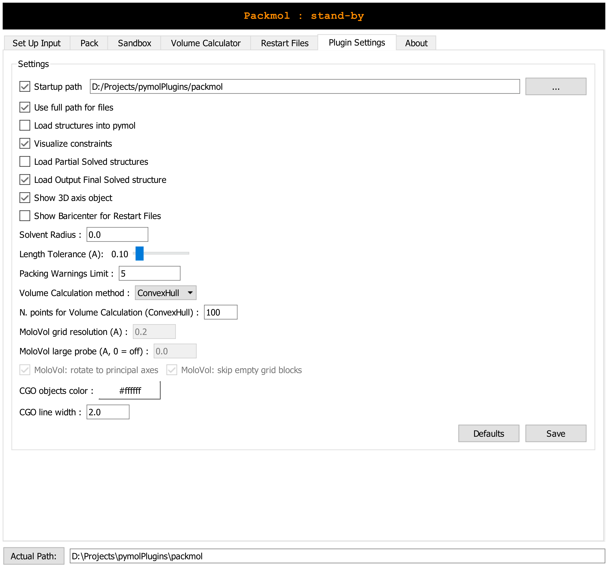
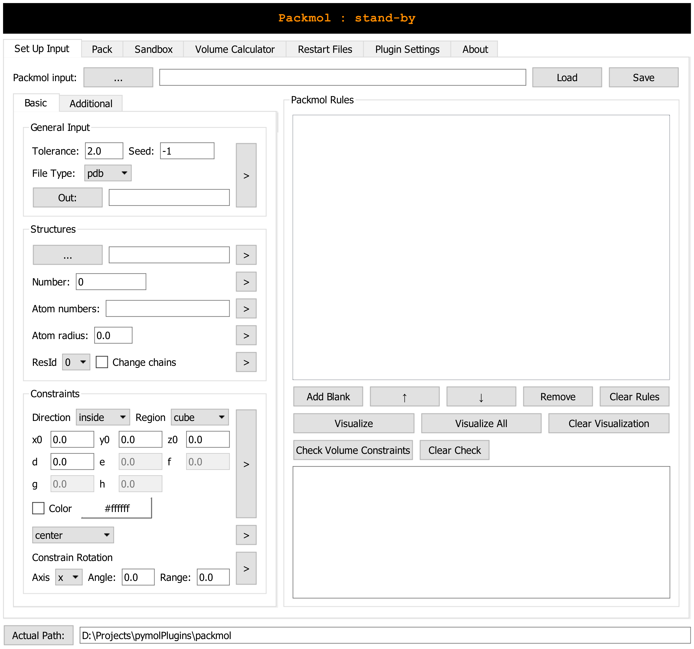
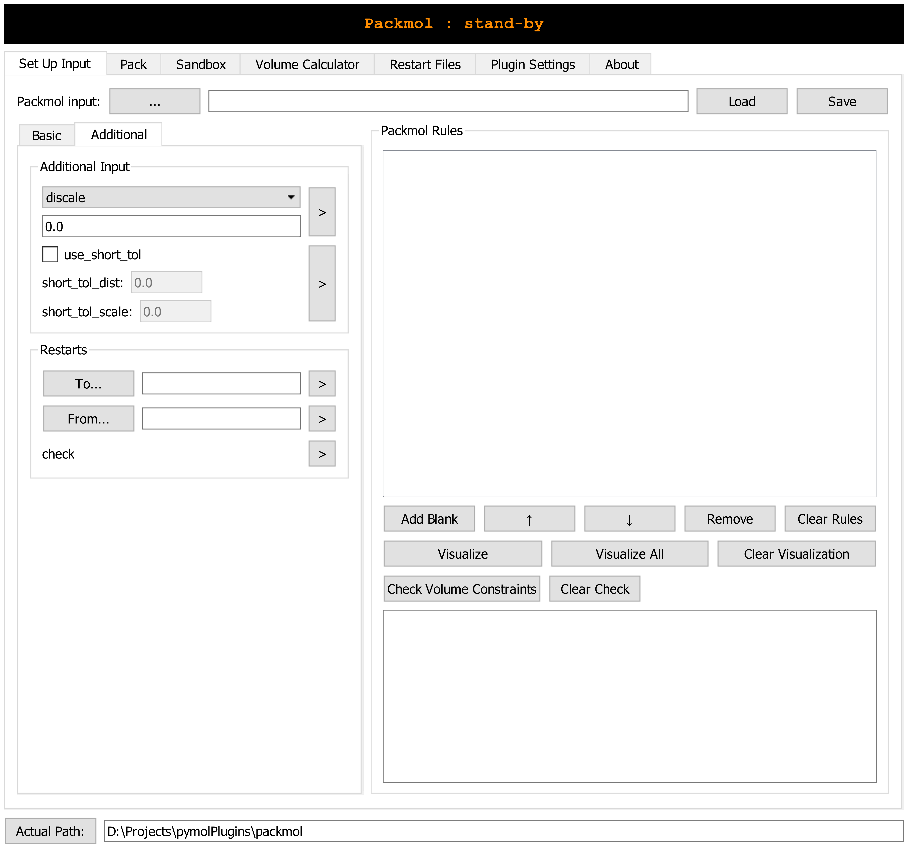
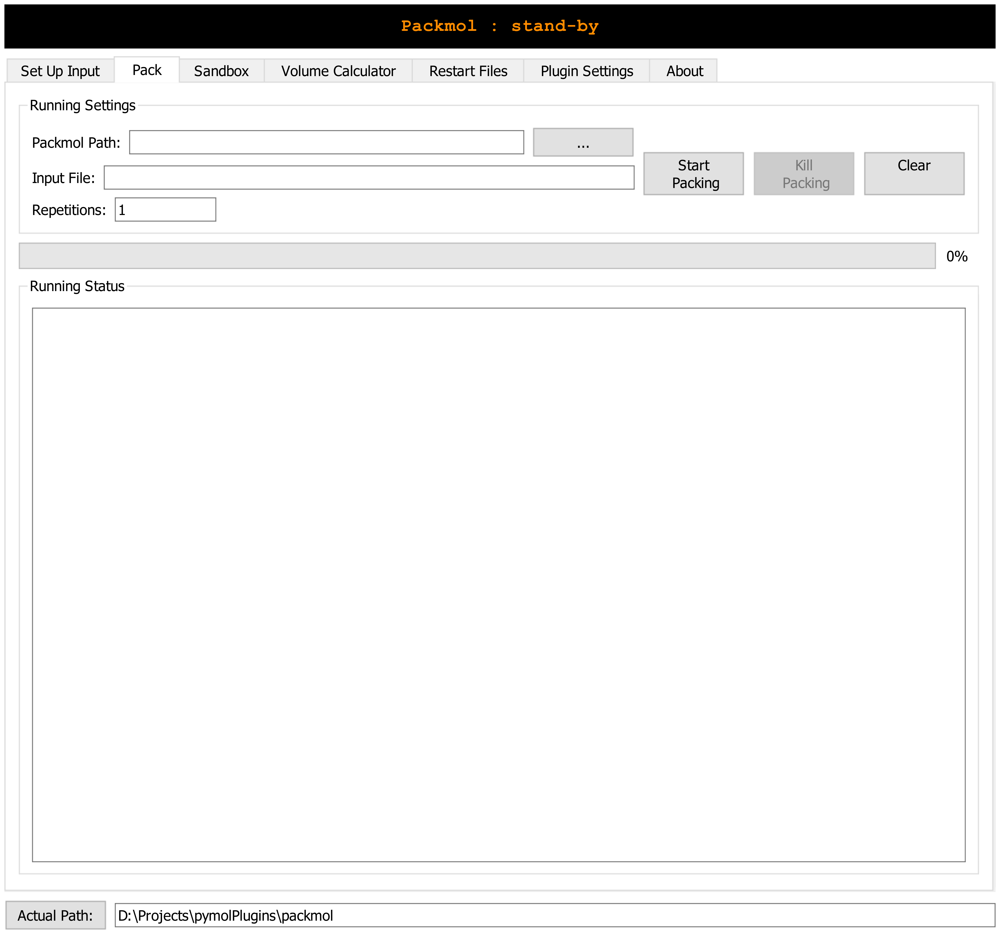
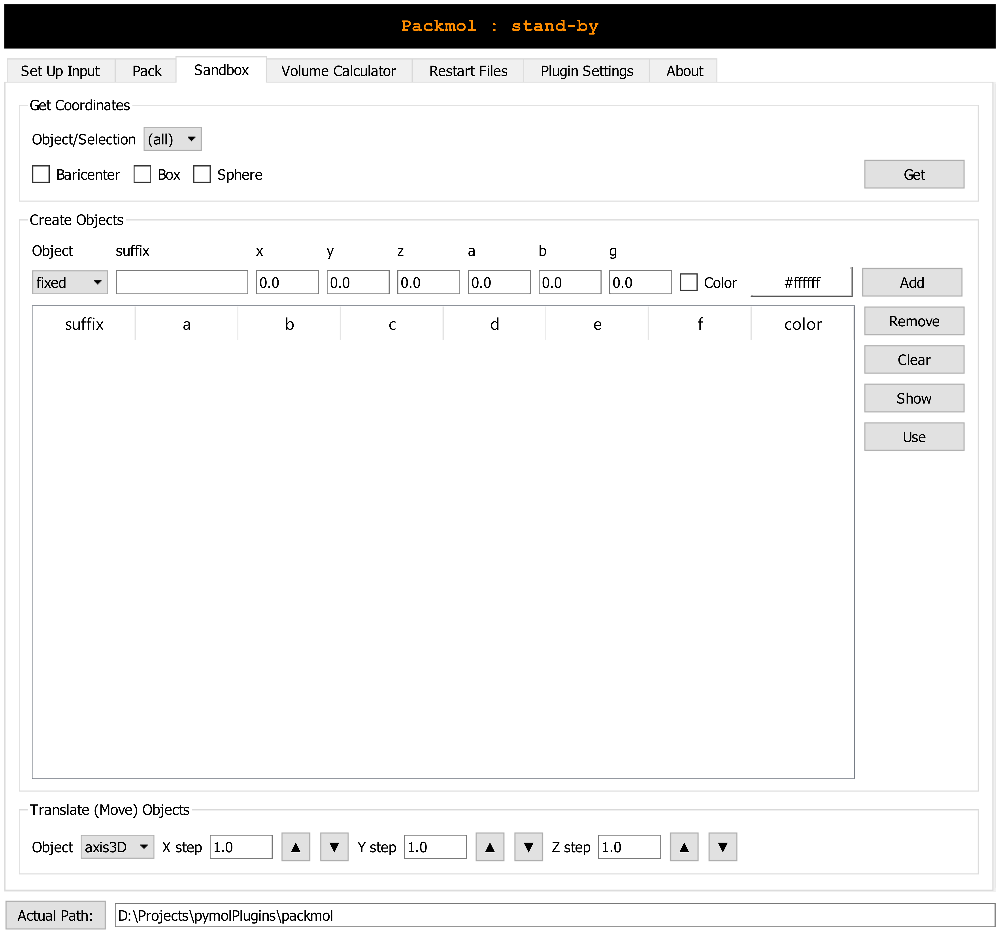
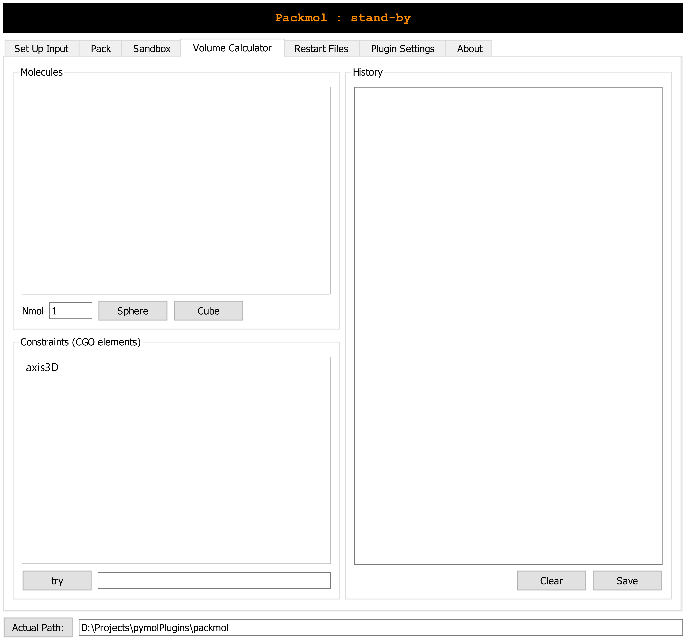
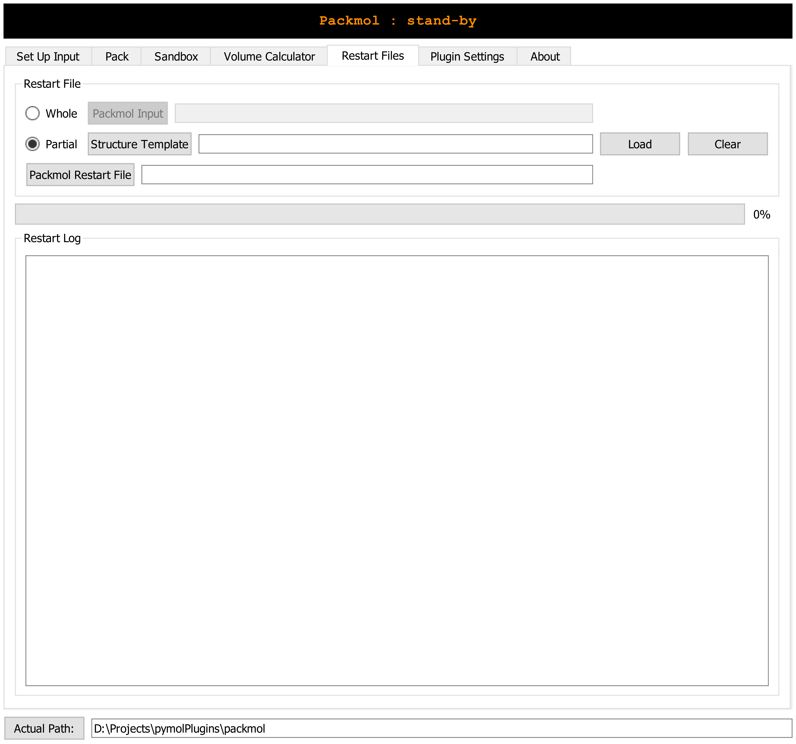

# pyPackmol: User Guide (v0.56)

pyPackmol is a PyMOL plugin that gives [Packmol](https://m3g.github.io/packmol/) a graphical
interface inside PyMOL.
With it you can:

- build Packmol input files (`.inp`) from a rules tree, without typing keywords by hand;
- see the spatial constraints (boxes, spheres, cylinders, planes…) as 3D objects in PyMOL;
- check that the constraints are large enough for the molecules you want to pack;
- run Packmol in the background and load the result into PyMOL;
- create and move helper boxes and spheres around existing molecules;
- estimate molecular and constraint volumes;
- rebuild a packed system from Packmol restart files.

---

## 1. Requirements

- PyMOL 2.0 or later (with its Qt interface). PyMOL 2.5+ or 3.x is recommended.
- NumPy and SciPy available in PyMOL's Python. SciPy is needed for the volume checks.
  To check, run `import numpy, scipy` in the PyMOL command line.
- A Packmol executable. If `packmol` is on your `PATH`, the plugin finds it automatically.

## 2. Installation

1. Copy the plugin folder **without** the `legacy/` and `docs/` subfolders, but keep `LICENSE` and
   `LICENSE-MoloVol.txt` in it. The folder name must be a valid Python package name, for example
   `pyPackmol`.
2. In PyMOL, open **Plugin → Plugin Manager → Install New Plugin → Choose file…** and select
   `pyPackmol/__init__.py`. You can also copy the folder into PyMOL's plugins directory.
3. If an older Tk version (v0.46) is installed, remove it first under **Installed Plugins**.
4. Restart PyMOL.
5. Open the plugin with **Plugin → pyPackmol**.

Closing the plugin window only hides it. Opening it again from the menu brings back the same window,
with its rules tree and logs intact. Packmol runs continue while the window is closed.

## 3. The main window

At the top of the window is a black **status bar**. It shows what the plugin is doing:

| Status | Meaning |
|---|---|
| `Packmol : stand-by` | Idle. |
| `Packmol : Calculating Volume` | A volume check is running. |
| `Packmol :  p a c k i n g` | Packmol is running. |
| `Packmol : loading restart file` | A restart file is being rebuilt. |

**Double-click the status bar** to save an image of the plugin window (PNG, 600 dpi, about 6× the
screen size on a standard 96 dpi display). The window is redrawn at that resolution, so text stays
sharp, and windows that cover the plugin are not captured. This is useful for figures and tutorials.
The screenshots in this guide were made this way.

At the bottom of the window, under every tab, is the **Actual Path** row: PyMOL's working directory.
Click **Actual Path:** to choose another folder (same as PyMOL's `cd`). Relative paths (structure
files, input and output files, restart files) are resolved from it, and Packmol runs in it. The
field updates when you change directory in PyMOL's command line and come back to the window.
With *Startup path* set in Plugin Settings, opening the window switches to that folder.

Below the status bar are seven tabs:

1. **Set Up Input**: build, load and save Packmol input files.
2. **Pack**: run Packmol.
3. **Sandbox**: create helper objects from molecules and move objects.
4. **Volume Calculator**: molecular and constraint volumes.
5. **Restart Files**: rebuild systems from Packmol restart files.
6. **Plugin Settings**: options used by the other tabs.
7. **About**: author, version, the pyPackmol license (GNU GPL v3, see `LICENSE`) and the MoloVol
   license notice (MIT, see `LICENSE-MoloVol.txt`).

With **Show 3D axis object** on (the default), an `axis3D` object is drawn in the lower-left corner of
the PyMOL viewport to show the X, Y and Z directions.

**Numbers:** every numeric field uses a dot (`.`) as decimal separator, whatever your system locale.
Letters are rejected.

---

## 4. Plugin Settings

Check these first, because the other tabs use them.



| Setting | Default | Effect |
|---|---|---|
| Startup path | off, empty | When ticked, opening the plugin window changes the Actual Path to this folder (pick it with `...`). A folder that doesn't exist is reported in the PyMOL console and ignored. |
| Use full path for files | on | `structure`, `output`, `restart_to` and `restart_from` rules get the absolute path of the file. Unticked, the path is written relative to the Actual Path (just the file name when the file is in that folder); a file on another drive keeps its absolute path. Paths with spaces trigger a warning, because Packmol stops reading at the first space. |
| Load structures into pymol | off | Load each structure file into PyMOL when its `structure` rule is added, visualized or read from a file. |
| Visualize constraints | on | Draw each constraint as soon as it is added, and draw all constraints when an input file is loaded. |
| Load Partial Solved structures | off | While Packmol runs, load each intermediate solution as an object called `partial`. |
| Load Output Final Solved structure | on | Load the Packmol output file when a run ends. |
| Show 3D axis object | on | Show or hide the `axis3D` object. |
| Show Baricenter for Restart Files | off | Mark the centre of each rebuilt molecule with a pseudoatom (Restart Files tab). |
| Solvent Radius | 0.0 | Probe radius for molecular volumes (both methods). With MoloVol, 0 gives the van der Waals volume only; 1.2–1.4 Å also counts cavities that the solvent can't reach. |
| Length Tolerance (A) | 0.10 | Extra length (0.05–1.00 Å) added when comparing molecule and constraint sizes. |
| Packing Warnings Limit | 5 | How many times a failed Packmol run is retried before giving up. |
| Volume Calculation method | ConvexHull | How molecular volumes are computed (see below). |
| N. points for Volume Calculation (ConvexHull) | 100 | Points per atom used by ConvexHull. More points are more accurate and slower. Enabled only for ConvexHull. |
| MoloVol grid resolution (A) | 0.2 | Voxel edge used by MoloVol. Smaller is more accurate, slower and uses more memory. Enabled only for MoloVol. |
| MoloVol: rotate to principal axes | on | Grid the molecule along its principal axes when that gives a smaller grid. Faster for elongated molecules; changes the volume by less than 0.1 %. Enabled only for MoloVol. |
| MoloVol: skip empty grid blocks | on | Process only grid blocks near atoms. Same result, faster. Enabled only for MoloVol. |
| MoloVol large probe (A, 0 = off) | 0.0 | Second, larger probe for MoloVol two-probe mode; it must be larger than Solvent Radius. Enabled only for MoloVol. |
| CGO line width | 2.0 | Line width of all CGO objects (PyMOL's `cgo_line_width`), applied when you leave the field. |
| CGO objects color | `#ffffff` | Default colour of constraint and Sandbox objects. Changing it redraws all constraints that don't have their own colour. |

**Volume Calculation methods**

- **ConvexHull** (default): points on the solvent-accessible surface of every atom, wrapped in a
  convex hull (SciPy). Fast; it overestimates concave molecules, because the hull fills their grooves.
- **MoloVol**: the [MoloVol](https://github.com/jmaglic/MoloVol) algorithm (J. B. Maglic and
  R. Lavendomme, MIT license), in pure Python with NumPy. Atoms are mapped onto a grid, and the
  volume is the van der Waals volume plus the voids the probe can't reach. Radii are the atoms'
  `vdw` values in PyMOL (change them with `alter sel, vdw=...`). By default empty grid regions are
  skipped and elongated molecules are turned to their principal axes first, so large molecules run
  much faster than a plain grid would (both can be switched off; the rotation changes the result by
  less than 0.1 %). Still
  slower and more memory-hungry than ConvexHull for large molecules or fine grids; if memory runs out, an error box asks you to increase the grid
  resolution.

Picking a method also sets *Solvent Radius* to that method's default: 1.2 Å for MoloVol, 0.0 for
ConvexHull. You can change it afterwards. Changing the method clears the molecular volumes already
computed in the Volume Calculator.

- **Save** stores the settings in PyMOL's preferences, so they are kept between sessions.
- **Defaults** restores the values above. Click **Save** afterwards to keep them.

---

## 5. Set Up Input

This tab builds a Packmol input file as a **rules tree**. The left side has two sub-tabs
(**Basic** and **Additional**) with fields and `>` buttons. Each `>` button adds a rule to the
**Packmol Rules** tree on the right. The tree mirrors the structure of a `.inp` file:
`structure` and `atoms` rules are blocks that contain other rules.



### 5.1 Where new rules go

- General rules (tolerance, output, additional options…) are added at the top level.
- Rules that belong to a structure (`number`, `atoms`, `changechains`, `resnumbers`,
  `constrain_rotation`, `nloop`, `fscale`) need a selected rule in the tree. They go into the selected
  `structure` block, or into the structure that contains the selected rule. Selecting an `atoms` rule
  and adding `number` puts it into the structure, not into `atoms`.
- Constraints, `center`, `radius`, `short_radius` and `short_radius_scale` go into the selected
  `structure` or `atoms` block (or the block that contains the selected rule).
- `pbc` is global: it always goes to the top level, whatever is selected.
- If nothing is selected, structure-level rules are not added, and a message is printed in the
  PyMOL console.

### 5.2 Basic sub-tab

**General Input**

| Field | Rule |
|---|---|
| Tolerance | `tolerance 2.0` (minimum distance between molecules, Å) |
| Seed | `seed -1` (`-1` picks a random seed) |
| File Type | `filetype pdb`, `filetype xyz` or `filetype tinker` |
| Out: | `output <file>` (opens a *save* dialog; `.pdb` is added if you type no extension) |

The `>` button adds all four rules at once. If **Out:** is empty, it becomes `output.pdb` (or
`output.xyz`).

**Structures**

| Field | Rule |
|---|---|
| `...` + `>` | `structure <file>`. Pick the molecule file with `...`. If the file doesn't exist, you get a warning, but the rule is added anyway. With *Load structures into pymol* on, the molecule is loaded (`water`, then `water_1`…). |
| Number | `number N`, inside the structure. |
| Atom numbers | `atoms 1 2 3 …`, a block inside the structure for rules that apply to some atoms only. |
| Atom radius | `radius R`, inside the selected structure or atoms block. |
| ResId + Change chains | Adds `resnumbers` with the chosen ResId value (0–3), and `changechains` when ticked (Packmol turns it on whenever the keyword is present). |

**Constraints**

Pick a **Direction** (`inside`, `outside`, `over`, `above`, `below`, `pbc`) and a **Region**. The parameter
fields are enabled and relabelled for that region:

| Region | Parameters | Meaning |
|---|---|---|
| `cube` | x0 y0 z0 d | Corner and side length. |
| `box` | x0 y0 z0 x1 y1 z1 | Minimum and maximum corners. |
| `sphere` | a b c d | Centre and radius. |
| `ellipsoid` | a1 b1 c1 a2 b2 c2 d | Centre, semi-axes, and size. |
| `cylinder` | a1 b1 c1 a2 b2 c2 d l | Base point, axis direction, radius, length. |
| `plane` | a b c d | Plane `a·x + b·y + c·z = d` (use with `over`/`above`/`below`). |
| `xygauss` | a1 b1 a2 b2 c h | Gaussian surface. |
| `fixed` | x y z a b g | Fixed position and Euler angles. Direction is not used. |

See the Packmol documentation for the exact meaning of each parameter.

**Periodic boundary conditions (`pbc`)**: choosing the `pbc` direction sets Region to `box` and
locks it until you pick another direction. Fill x0 y0 z0 x1 y1 z1 like a box, then click `>`:

- x1, y1, z1 all `0`: only the first three values are written, e.g. `pbc 30.0 30.0 30.0`
  (Packmol reads them as the box maximum, from 0).
- Otherwise x1, y1, z1 must be greater than x0, y0, z0, and all six are written, e.g.
  `pbc 0.0 0.0 0.0 30.0 30.0 30.0`. If not, an error box appears and no rule is added.

`pbc` is added at the top level (it is a global keyword) and drawn as a box object named
`pbc_box`, with the chosen colour.

- **Color**: tick it and pick a colour to give the next constraint its own colour. The rule shows a
  colour swatch in the tree. Unticked, the constraint uses the CGO colour from Plugin Settings.
- **`>`** adds the constraint, e.g. `inside box 0.0 0.0 0.0 40.0 40.0 40.0`. With *Visualize
  constraints* on, it is drawn immediately as a CGO object named after the structure and region
  (`water_box`, `water_box1`…).
- **Center `>`** adds `center` or `centerofmass` (chosen in the drop-down; Packmol treats them the same).
- **Constrain Rotation** (Axis, Angle, Range) adds `constrain_rotation x 0.000 0.000`.

### 5.3 Additional sub-tab



**Additional Input** offers the other Packmol options from a drop-down list:
`discale`, `maxit`, `add_box_sides`, `sidemax`, `avoid_overlap`, `nloop`, `precision`, `writeout`,
`iprint1`, `iprint2`, `fbins`, `fscale`, `movebadrandom`, `add_amber_ter`, `randominitialpoint`,
`writebad`, `chkgrad`, `short_radius`, `short_radius_scale`, `movefrac`, `disable_movebad`,
`packall`, `amber_ter_preserve`, `writecrd`, `hexadecimal_indices`, `ignore_conect`,
`non_standard_conect`, `nloop0`, `maxmove`, `chain`, `segid`, `connect`.

- Each option remembers the value you typed for it while you switch between options.
- Flag options (`movebadrandom`, `add_amber_ter`, `randominitialpoint`, `writebad`, `chkgrad`,
  `disable_movebad`, `packall`, `amber_ter_preserve`, `hexadecimal_indices`, `ignore_conect`,
  `non_standard_conect`) take no value, so the field is disabled.
- For `avoid_overlap`, type `1` for `yes`; anything else gives `no`. For `connect`, `no` (or `0`)
  gives `connect no` (no CONECT records for that structure); anything else gives `yes`.
- `writecrd`, `chain` and `segid` take a word: the CRD file name (default `output.crd`), the chain
  and the segment identifier (default `A`). Empty values are refused.
- `nloop0` (default 1000) sets the loops of Packmol's initial phase. It is not in the Packmol user
  guide, but Packmol suggests it when that phase runs out of loops.
- `sidemax` defaults to 2000.0. It is also used by the volume check for `outside` constraints.
- `nloop`, `fscale`, `maxmove`, `chain`, `segid` and `connect` go inside a structure.
  `short_radius` and `short_radius_scale` go inside a structure or atoms block. All other options,
  including `nloop0`, go to the top level.
- `chain` and `changechains` can't be used together in one structure: Packmol stops with an error,
  and Check Volume Constraints writes a NOTE.

**use_short_tol**: tick it, fill in `short_tol_dist` and `short_tol_scale`, and click `>` to add the
three rules.

**Restarts**

- **To… `>`** adds `restart_to <file>`: Packmol will write a restart file there.
- **From… `>`** adds `restart_from <file>` and tells you how many molecular elements the file holds.
- With a structure selected, the rule goes inside that structure (restart for that molecule type
  only). With nothing selected, it goes to the top level (restart for the whole system).
- **check `>`** adds `check`: Packmol only builds the initial guess, without optimizing.

### 5.4 Editing the rules tree

| Action | How |
|---|---|
| Edit a rule | Double-click it (or press F2). Enter confirms, Esc cancels. Editing a constraint redraws it. |
| Change a constraint's colour | Double-click the colour swatch at the left of the constraint (or `pbc`) rule and pick a colour. The constraint and its label are redrawn. Typing `# color #rrggbb` at the end of the rule does the same. |
| Insert a rule by hand | **Add Blank** inserts an empty rule before the selected one and opens it for editing. |
| Reorder | **↑** / **↓** move the selected rule within its parent, together with its children. |
| Delete | **Remove** deletes the selected rule, its children and their 3D objects. |
| Start over | **Clear Rules** empties the tree and deletes all objects drawn from it. |

### 5.5 Visualizing constraints

- **Visualize** draws the constraints of the structure that contains the selected rule.
- **Visualize All** draws every constraint in the tree.
- **Clear Visualization** deletes the plugin's constraint objects. Molecules are not touched.
- Editing a constraint rule in the tree (double-click) redraws its object in place: the object keeps
  its name (e.g. `water_box`) unless you change the region, and no copy is left behind. Pressing
  **Visualize** again also replaces the objects instead of adding new ones. Editing doesn't ask to
  reload the structure.

When *Load structures into pymol* is on, Visualize also loads the structure. If an object with that
name already exists, the plugin asks whether to reload it.

A `plane` is drawn with the size of the previous `cube`, `box` or `sphere` in the same structure, or
0–50 Å if there is none. If you edit that constraint in Packmol Rules, the planes already drawn after
it are redrawn with the new size. Planes and `xygauss` surfaces are not used for volume checks.

A constraint with the wrong number of parameters, or a non-numeric one, is not drawn: a message is
printed in the PyMOL console, and Check Volume Constraints reports the rule and skips it.

**Labels.** Every constraint drawn from this tab (including `pbc`) also gets a label: a hidden
pseudoatom named after the CGO plus `_lbl` (e.g. `water_box_lbl`), placed on a point of the drawn
constraint and showing the CGO name in the constraint's colour. Each label is put at least 5 Å
from the other constraint labels when the constraint allows it. Labels are removed and redrawn
together with their constraint, and they don't appear in the Volume Calculator or Sandbox lists.
Sandbox objects get no label.

### 5.6 Loading and saving input files

The **Packmol input:** row at the top of the tab handles `.inp` files:

- **`...`** picks an input file and reads it.
- **Load** reads the file whose path is typed in the field. If the path doesn't exist, it opens the
  file dialog instead.
- **Save** writes the tree to a `.inp` file, indented by two spaces, with `end atoms` /
  `end structure` lines. A constraint with its own colour gets a `# color #rrggbb` comment at the end
  of its line; Packmol ignores it.

Reading a file replaces the whole tree. Comments (whole lines starting with `#` and everything from
a `#` to the end of a line) and blank lines are skipped, and keywords are case-insensitive. The only
comment that is read is `# color #rrggbb` on a constraint line: it sets the constraint's colour and
is not shown in the rule. **Out:** is filled from the file's `output` rule. A constraint takes the colour
from its `# color` comment; the others get a random colour, so overlapping constraints are easy to
tell apart. With *Visualize constraints* on, all the constraints are drawn.

The input file path is also shown in the Pack tab, which runs that file.

### 5.7 Checking volumes

**Check Volume Constraints** compares, for each structure, the volume and length of the molecules with
those of their `inside`/`outside` constraints. For each constraint the report shows:

```
volMol= …   volConst= …
lenMol= …   lenConst= …
```

- `volMol` is the molecule's volume multiplied by `number`.
- `lenMol` is the molecule's longest dimension; `lenConst` is the constraint's longest dimension.
- `OK.` means the constraint looks large enough. A `WARNING` line means the volume or the length of
  the constraint is too small.
- For two nested constraints in the same structure (e.g. `inside box` + `inside sphere`), the
  intersection volume and the final available volume are also printed. Deeper nesting is not checked.
- For `outside` constraints, the available volume is that of a cube of side `sidemax` minus the
  constraint.
- A `pbc` rule inside a structure (or its `atoms` blocks) gives a `NOTE`: Packmol accepts it, but
  it is a global keyword and belongs at the top level. A top-level `pbc` is not checked.

Structure files must exist relative to PyMOL's current directory (see **Actual Path** at the
bottom of the window). The check uses the *Volume Calculation method* and its settings, *Solvent Radius* and
*Length Tolerance* from Plugin Settings. The report starts with the method used.
**Clear Check** empties the report.

---

## 6. Pack

This tab runs Packmol on the input file from the Set Up Input tab.



| Field | Description |
|---|---|
| Packmol Path | The Packmol executable. Pre-filled if `packmol` is on `PATH`; otherwise pick it with `...`. |
| Input File | Read-only copy of the Set Up Input file path. Save or load the input there first. |
| Repetitions | How many packings to run in a row with the same input. |

**Start Packing** runs Packmol in the background: PyMOL stays responsive while it works. The
**Running Status** log shows Packmol's progress lines, and the progress bar shows the fraction of
repetitions done.

When a run succeeds:

- with *Load Output Final Solved structure* on, the output file is loaded (`out`, `out_1`…);
- with more than one repetition, each output file is renamed with a number, e.g. `out_1.pdb`,
  `out_2.pdb`, `out_3.pdb`, so the next run doesn't overwrite it.

Repetitions only give different results with `seed -1` in the input. With any other seed, or with
no `seed` rule (Packmol then uses a fixed default seed), Start Packing asks whether to proceed with
only one run. **Yes** sets Repetitions to 1 and runs; **Cancel** starts nothing.

When a run fails (no solution within Packmol's iterations), it is retried. After *Packing Warnings
Limit* failures:

- with one repetition, packing stops;
- with several repetitions, a dialog asks whether to proceed to the next packing. **No** stops
  everything. **Yes** moves on, and the log says `User override`.

Other buttons:

- **Kill Packing** stops the running Packmol process.
- **Clear** empties the log and resets the progress bar. If Packmol is running, it is killed first.

Common errors:

| Message | Cause |
|---|---|
| `Packmol not found !` | Packmol Path is wrong. |
| `Input File not found !` | Save or load an input file in Set Up Input first. |
| `"output" keyword Not or Wrong defined in input file !` | The input has no `output` rule. |
| `Structure kw refers to an inexistent file!` | A `structure` file doesn't exist relative to Actual Path. |
| `Initial constraints too tight !` | Packmol couldn't place the molecules. Enlarge the constraints or reduce `number`. |
| `Could not start Packmol` | The Packmol path is not an executable. |

---

## 7. Sandbox

The Sandbox creates helper boxes, spheres and points, so you can find good constraint values before
adding them to the input.



### 7.1 Get Coordinates

Choose a PyMOL object or selection in **Object/Selection** (the list refreshes when opened; `(all)` is
everything), tick one or more of the options and click **Get**:

| Option | Object created | Values |
|---|---|---|
| Baricenter | `fixed_<name>`, a small cross | Centre of the bounding box. |
| Box | `box_<name>` | Bounding box, enlarged by the largest van der Waals radius. |
| Sphere | `sphere_<name>` | Sphere that encloses that box. |

Each object is also added as a row of the table.

### 7.2 Create Objects

Choose **Object** (`fixed`, `box` or `sphere`), type a **suffix** and the parameters, and click
**Add**. The object is named `<type>_<suffix>`. Tick **Color** to give it its own colour; otherwise
the CGO colour from Plugin Settings is used.

### 7.3 The objects table

| Action | How |
|---|---|
| Change a value | Edit the cell. The object is redrawn. |
| Rename | Edit the *suffix* cell. The type prefix (e.g. `box_`) is kept. Empty or existing names are refused. |
| Change colour | Double-click the *color* cell. |
| Redraw | **Show** |
| Delete one / all | **Remove** / **Clear** (also deletes the PyMOL objects). |
| Use as constraint | **Use** copies the selected row's region, values and colour into the Constraints group of Set Up Input. Then select a structure there and click `>`. |

### 7.4 Translate (Move) Objects

Choose any molecule or CGO in **Object**, set the X, Y and Z steps (Å), and click **▲** or **▼** to
move it by +step or −step along that axis. If the object is in the Sandbox table, its row is selected
and updated, so **Use** sends the new coordinates.

---

## 8. Volume Calculator

The **Molecules** and **Constraints (CGO elements)** lists refresh when you open the tab or move the
mouse over them. All results go to the **History** log.



- **Double-click a molecule**: its volume (ų) and length (Å). If **Nmol** is greater than 1, the
  total volume for Nmol molecules is shown too.
- **Double-click a constraint**: its volume and length. This only works for objects drawn by the
  plugin (Set Up Input or Sandbox), not for `axis3D` or other CGOs.
- **Sphere** / **Cube**: with a molecule selected, the radius of the sphere or the side of the cube
  needed to hold **Nmol** molecules. The size is never smaller than the molecule's length plus the
  Length Tolerance.
- **try**: select a molecule (it appears next to the button) and a constraint, then click **try** to
  get the approximate number of molecules that fit in that constraint. If the molecule is longer than
  the constraint, the minimum constraint length is shown.
- **Save** writes the History to a text file. **Clear** empties it.

Molecular volumes use the *Volume Calculation method* chosen in Plugin Settings (the History names
it), with *Solvent Radius* and the method's settings. These are estimates: actual packing
needs more space than the molecular volume, because of the Packmol tolerance.

---

## 9. Restart Files

Packmol can write restart files (`restart_to`, see 5.3) with the position and orientation of every
molecule. This tab rebuilds the packed coordinates from such a file and loads them into PyMOL.



1. Pick the **Packmol Restart File** (`.pack`).
2. Choose a mode:
   - **Partial** (default): pick a **Structure Template**, a single molecule file. Every line of the
     restart file becomes a copy of that molecule. Use this for restart files written inside a
     `structure` block.
   - **Whole**: pick the **Packmol Input** file used for the run. The plugin reads its `structure`
     and `number` rules, and assigns the restart lines to each structure in order. The numbers must
     add up to the number of lines in the restart file. Use this for a top-level `restart_to`.

   Only the field of the chosen mode can be used: with Partial, *Packmol Input* is greyed out;
   with Whole, *Structure Template* is. **Clear** empties the fields, the log and the progress bar,
   and sets the mode back to Partial.
3. Click **Load**.

The result is a single object named after the restart file, in which each molecule has its own residue
number. The log shows the rotation matrix and translation used for each molecule, and ends with `EOF`.
With *Show Baricenter for Restart Files* on, a `baricenter_<name>` pseudoatom marks each molecule's
centre.

---

## 10. Example: water and urea in a box

1. **Plugin Settings**: tick *Load structures into pymol*, keep *Visualize constraints* on, and click
   **Save**.
2. At the bottom of the window, click **Actual Path:** and choose the folder that contains `water.pdb` and `urea.pdb`.
3. **Set Up Input → Basic**:
   1. Keep Tolerance 2.0 and File Type `pdb`, set **Out:** to `mixture.pdb`, and click `>`.
   2. Pick `water.pdb` with `...` and click `>`. Select the new `structure water.pdb` rule.
   3. Number `500`, click `>`.
   4. Region `box`, Direction `inside`, parameters `0 0 0 30 30 30`, click `>`. The box appears in
      PyMOL.
   5. Repeat steps 2–4 for `urea.pdb` with Number `50` and the same box.
4. Click **Check Volume Constraints** and look for `OK.` in the report.
5. Click **Save** in the *Packmol input:* row and save as `mixture.inp`.
6. **Pack**: check Packmol Path and click **Start Packing**. When it finishes, `mixture` is loaded.

The saved file looks like this:

```
tolerance 2.0
filetype pdb
seed -1
output mixture.pdb
structure water.pdb
  number 500
  inside box 0.0 0.0 0.0 30.0 30.0 30.0
end structure
structure urea.pdb
  number 50
  inside box 0.0 0.0 0.0 30.0 30.0 30.0
end structure
```

---

## 11. Example: lipid bilayer

This example builds `testing/bilayer-color.inp`: a lipid bilayer between two layers of water, all
40 × 40 Å in x and y.

| Structure | Number | Region (z, Å) |
|---|---|---|
| `water.pdb` | 500 | −10 to 0, below the bilayer |
| `water.pdb` | 500 | 28 to 38, above the bilayer |
| `palmitoil.pdb` | 50 | 0 to 14, lower lipid layer |
| `palmitoil.pdb` | 50 | 14 to 28, upper lipid layer |

In each lipid layer, two `atoms` blocks hold the two ends of the molecule on opposite sides of
the layer: atoms 31 and 32 below one plane, atoms 1 and 2 above another. The lipids therefore stand
along z, and the two layers point in opposite directions.

You need `water.pdb` and `palmitoil.pdb`, which come with the
[Packmol examples](https://m3g.github.io/packmol/examples.shtml).

To see the finished input first, set **Actual Path** to that folder, click `...` in the
*Packmol input:* row and open `testing/bilayer-color.inp`. Click **Clear Rules** to build it
yourself.

1. **Plugin Settings**: tick *Load structures into pymol*, keep *Visualize constraints* on, and click
   **Save**. Untick *Use full path for files* if you want plain file names in the input, as below.
2. At the bottom of the window, click **Actual Path:** and choose the folder that contains
   `water.pdb` and `palmitoil.pdb`.
3. **Set Up Input → Basic**: keep Tolerance 2.0 and File Type `pdb`, set **Out:** to
   `bilayer-color.pdb`, and click `>`.
4. **Water below the bilayer**:
   1. Pick `water.pdb` with `...` and click `>`. Select the new `structure water.pdb` rule.
   2. Number `500`, click `>`.
   3. Optional: tick **Color** and pick a colour. The next constraint gets that colour.
   4. Direction `inside`, Region `box`, parameters `0 0 -10 40 40 0`, click `>`.
5. **Water above the bilayer**: repeat step 4 with the box `0 0 28 40 40 38`.
6. **Lower lipid layer**:
   1. Pick `palmitoil.pdb` with `...` and click `>`. Select the new `structure palmitoil.pdb` rule.
   2. Number `50`, click `>`.
   3. Direction `inside`, Region `box`, parameters `0 0 0 40 40 14`, click `>`.
   4. Type `31 32` in **Atom numbers** and click `>`. Select the new `atoms 31 32` rule.
   5. Direction `below`, Region `plane`, parameters `0 0 1 2`, click `>`. The constraint goes into
      the selected `atoms` block.
   6. Select the `structure palmitoil.pdb` rule again. Type `1 2` in **Atom numbers** and click `>`.
      Select the new `atoms 1 2` rule.
   7. Direction `over`, Region `plane`, parameters `0 0 1 12`, click `>`.
7. **Upper lipid layer**: repeat step 6 with these values:
   - box `0 0 14 40 40 28`;
   - `atoms 1 2` with `below plane 0 0 1 16`;
   - `atoms 31 32` with `over plane 0 0 1 26`.

   Add `atoms 1 2` first, so the order matches the file.
8. Click **Visualize All**. Each plane is drawn with the size of the box of its structure. If you
   edit a box, its planes are redrawn with the new size.
9. Click **Check Volume Constraints**. Only `inside`/`outside` rules at the structure level are
   checked, so each structure gets one result for its box; the planes are not checked. `OK.` means
   the box looks large enough, and a `WARNING` means it may be too small.
10. Click **Save** in the *Packmol input:* row and save as `bilayer.inp`.
11. **Pack**: check Packmol Path and click **Start Packing**.

The saved file looks like this. The `# color` comments only appear for constraints that have their
own colour; yours have the colours you picked.

```
tolerance 2.0
filetype pdb
seed -1
output bilayer-color.pdb
structure water.pdb
  number 500
  inside box 0.0 0.0 -10.0 40.0 40.0 0.0  # color #ff0004
end structure
structure water.pdb
  number 500
  inside box 0.0 0.0 28.0 40.0 40.0 38.0  # color #b700ff
end structure
structure palmitoil.pdb
  number 50
  inside box 0.0 0.0 0.0 40.0 40.0 14.0  # color #0000ff
  atoms 31 32
    below plane 0.0 0.0 1.0 2.0  # color #066aff
  end atoms
  atoms 1 2
    over plane 0.0 0.0 1.0 12.0  # color #aaaa00
  end atoms
end structure
structure palmitoil.pdb
  number 50
  inside box 0.0 0.0 14.0 40.0 40.0 28.0  # color #10a300
  atoms 1 2
    below plane 0.0 0.0 1.0 16.0  # color #aaaa00
  end atoms
  atoms 31 32
    over plane 0.0 0.0 1.0 26.0  # color #0055ff
  end atoms
end structure
```

Apart from the number format, it differs from `testing/bilayer-color.inp` only in the `seed -1` line,
which the Basic `>` button adds.

---

## 12. Example: spherical vesicle

This example builds `testing/spherical_color.inp`: a vesicle made of two lipid layers, with water
inside and outside. Everything is centred on the origin.

| Structure | Number | Region (distance from the centre, Å) |
|---|---|---|
| `palmitoil.pdb` | 90 | inner lipid layer, 14 to 26 |
| `palmitoil.pdb` | 300 | outer lipid layer, 29 to 41 |
| `water.pdb` | 308 | inside the vesicle, up to 13 |
| `water.pdb` | 17536 | outside the vesicle: beyond 43, in a box 95 Å wide |

The lipids use `atoms` blocks again: atom 37 and atom 5 are the two ends of the molecule. In the inner
layer, atom 37 stays inside a 14 Å sphere and atom 5 outside a 26 Å sphere. The outer layer is
reversed: atom 5 inside 29 Å and atom 37 outside 41 Å. Each structure also has `resnumbers 2`.

Use the same files and settings as in section 11 (steps 1 and 2). To see the finished input first,
open `testing/spherical_color.inp`, then click **Clear Rules**.

1. **Set Up Input → Basic**: keep Tolerance 2.0, set **Out:** to `spherical.pdb`, and click `>`.
2. **Inner lipid layer**:
   1. Pick `palmitoil.pdb` with `...` and click `>`. Select the new `structure palmitoil.pdb` rule.
   2. Set **ResId** to `2`, leave *Change chains* unticked, and click `>`. This adds `resnumbers 2`.
   3. Number `90`, click `>`.
   4. Type `37` in **Atom numbers** and click `>`. Select the new `atoms 37` rule.
   5. Direction `inside`, Region `sphere`, parameters `0 0 0 14`, click `>`.
   6. Select the structure again. Type `5` in **Atom numbers** and click `>`. Select the new
      `atoms 5` rule.
   7. Direction `outside`, Region `sphere`, parameters `0 0 0 26`, click `>`.
3. **Outer lipid layer**: repeat step 2 with Number `300`, then `atoms 5` with
   `inside sphere 0 0 0 29`, then `atoms 37` with `outside sphere 0 0 0 41`.
4. **Water inside the vesicle**: add `structure water.pdb`, `resnumbers 2`, Number `308`, and
   `inside sphere 0 0 0 13`, as in step 2 (no `atoms` block).
5. **Water outside the vesicle**: add `structure water.pdb`, `resnumbers 2`, Number `17536`, then
   `inside box -47.5 -47.5 -47.5 47.5 47.5 47.5` and `outside sphere 0 0 0 43`.
6. Click **Visualize All**. The spheres are nested around the origin, so turn some objects off in
   the PyMOL object panel to see the inner ones.
7. Click **Check Volume Constraints**. The lipid structures only have constraints inside `atoms`
   blocks, so they are not checked. The outer water has two constraints at the structure level, so the
   report also prints their intersection volume and the final available volume.
8. Save as `spherical.inp` and pack. With about 18 000 water molecules, this run takes much longer than
   the other examples.

The saved file looks like this (colours as in `testing/spherical_color.inp`):

```
tolerance 2.0
filetype pdb
seed -1
output spherical.pdb
structure palmitoil.pdb
  resnumbers 2
  number 90
  atoms 37
    inside sphere 0.0 0.0 0.0 14.0  # color #ff0004
  end atoms
  atoms 5
    outside sphere 0.0 0.0 0.0 26.0  # color #bc0003
  end atoms
end structure
structure palmitoil.pdb
  resnumbers 2
  number 300
  atoms 5
    inside sphere 0.0 0.0 0.0 29.0  # color #ff5500
  end atoms
  atoms 37
    outside sphere 0.0 0.0 0.0 41.0  # color #c34100
  end atoms
end structure
structure water.pdb
  resnumbers 2
  number 308
  inside sphere 0.0 0.0 0.0 13.0  # color #00007f
end structure
structure water.pdb
  resnumbers 2
  number 17536
  inside box -47.5 -47.5 -47.5 47.5 47.5 47.5  # color #00ffff
  outside sphere 0.0 0.0 0.0 43.0  # color #0000c7
end structure
```

`testing/spherical_color.inp` has `output` first and no `filetype` or `seed` lines. Packmol reads
both versions the same way, except that `seed -1` gives a different random packing each run.

---

## 13. Tips and troubleshooting

- **Relative paths**: structure and output paths in the input are resolved from PyMOL's working
  directory (Actual Path at the bottom of the window). Set it before checking volumes or packing.
- **A rule doesn't get added**: structure-level rules need a selected rule in the tree. Look for
  `Nothing selected` in the PyMOL console.
- **A constraint isn't drawn**: check its parameters. A wrong number of values, or a non-numeric
  value, prints `Wrong parameters in rule` in the console.
- **Volume checks fail**: make sure SciPy is installed in PyMOL's Python.
- **Packing fails repeatedly**: run the volume check, enlarge the constraints, reduce `number`, or
  raise `maxit` / `nloop` in the Additional sub-tab.
- **After updating the plugin**, restart PyMOL. Reopening the window doesn't reload the code.
- **Error messages and tracebacks** appear in the PyMOL console. Include them when reporting a problem.
